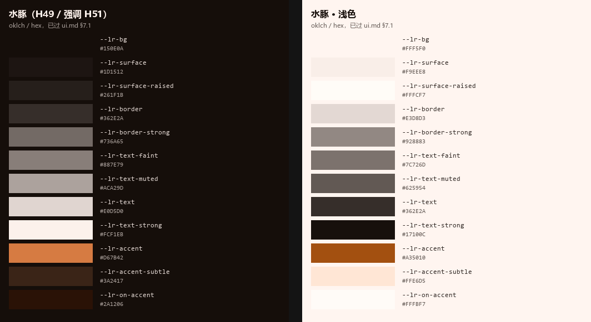
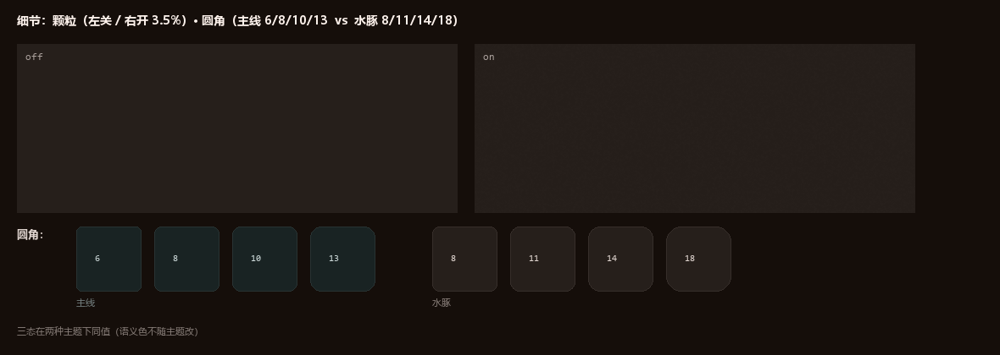

<!-- SPDX-FileCopyrightText: 2026 HanYang06 -->
<!-- SPDX-License-Identifier: Apache-2.0 -->

# 主题包：「水豚」

> **状态：已定，未实现。** 本文件是[路线 098「主题包与定制」](../roadmap/1.x-开发.md)的设计口径。
> 「水豚」是第一个主题包，色板来自标识（[proposals/logo.md](proposals/logo.md)）。
>
> **与 [ui.md](ui.md) 的关系**：ui.md 是**主线**（安静的那套），本文件是**可选包**。
> 主题包不得改主线的任何一条硬规则，只能在自己的作用域内覆盖令牌**值**。

<a id="r098"></a>

## 一、主题包怎么接进现有体系

三件事必须分开，否则主题会变成"另一套 UI"：

| 层 | 归属 | 主题包能不能改 |
| --- | --- | --- |
| **方案（scheme）**：深色 / 浅色 | ui.md §五，`[data-theme="dark"\|"light"]` | **不能**，只能各自给值 |
| **包（pack）**：默认 / 水豚 | 本文件，新增 `[data-pack="capybara"]` | 就是它 |
| **令牌名** | ui.md，两主题完全一致 | **一个都不许改** |

```html
<html data-theme="dark" data-pack="capybara">
```

**为什么是新增 `data-pack` 而不是把 `data-theme` 拆成两段**：`data-theme` 已经在
ui.md §五 里定死并被组件依赖，改它是全树改动；加一个属性是纯增量。
（若将来要更干净，可以把它重命名成 `data-theme` + `data-scheme`，那是独立的一次重构。）

**组件不得写 `if (pack)`**——与 ui.md §八「组件内不得出现十六进制字面量」同一条理由：
一旦有分支，就不再是"同一套界面换皮"。

## 二、色相从哪来：从标识算，不是挑的

标识的四个实色（[logo.md](proposals/logo.md) §一 的实测）在 OKLCH 下：

| 标识色 | 十六进制 | L | C | H |
| --- | --- | --- | --- | --- |
| 橙（主体受光面） | `#D67B42` | **0.672** | **0.134** | **50.7** |
| 棕（主体） | `#AF6640` | 0.584 | 0.108 | 47.3 |
| 浅褐（亮面） | `#E9C29D` | 0.839 | 0.066 | 65.2 |
| 水青（水线） | `#518F9F` | 0.614 | 0.068 | 216.3 |
| 暗部（耳、脚） | `#44373A` | 0.352 | 0.019 | 2.6 |
| 米白（底） | `#F8F5F7` | 0.973 | 0.004 | 337.4 |

两个结论直接决定了这一包：

1. **中性阶梯取暖色相 `H=49`**（棕 47.3 与橙 50.7 的中间值）。明度阶梯与彩度
   **一个数字都不动**——仍然是 ui.md §2.3 的 `0.170 → 0.205 → 0.245`、
   中性彩度 `0.014`。于是 §7.2 那张验证表**整张继承**，不是重新推一遍。
2. **强调色就是标识的橙本身**：`#D67B42` = `oklch(0.672 0.134 51)`。
   它**恰好落在 ui.md §2.2 规定的深色端舒适带（L 0.62–0.72）内**，彩度 0.134
   也几乎等于主线的 0.122。所以这枚强调色不是发明出来的，也不需要重新论证——
   它是被 ui.md 的规则**筛过一遍**的。
3. 主线强调色的 H196 是为了避开短波长光晕（ui.md §2.2）；本包用的是**长波长暖橙**，
   从一开始就不在光晕区间，这条理由对它不适用，但结论一致：可读。

## 三、颜色令牌



> 上图为按本文件令牌值渲染的色卡，不是界面截图。

### 3.1 深色（主）

| 令牌 | 值 | 十六进制 | 与主线的关系 |
| --- | --- | --- | --- |
| `--lr-bg` | `oklch(0.170 0.014 49)` | `#150E0A` | 仅换色相 |
| `--lr-surface` | `oklch(0.205 0.014 49)` | `#1D1512` | 仅换色相 |
| `--lr-surface-raised` | `oklch(0.245 0.014 49)` | `#261F1B` | 仅换色相 |
| `--lr-border` | `oklch(0.310 0.014 49)` | `#362E2A` | 仅换色相 |
| `--lr-border-strong` | `oklch(0.530 0.014 49)` | `#736A65` | 仅换色相 |
| `--lr-text-faint` | `oklch(0.600 0.014 49)` | `#887E79` | 仅换色相 |
| `--lr-text-muted` | `oklch(0.720 0.014 49)` | `#ACA29D` | 仅换色相 |
| `--lr-text` | `oklch(0.880 0.014 49)` | `#E0D5D0` | 仅换色相 |
| `--lr-text-strong` | `oklch(0.965 0.014 49)` | `#FCF1EB` | 仅换色相 |
| `--lr-accent` | `oklch(0.672 0.134 51)` | `#D67B42` | **标识的橙，逐字相同** |
| `--lr-accent-subtle` | `oklch(0.285 0.040 51)` | `#3A2417` | 结构同主线（L 0.285 / C 0.040） |
| `--lr-on-accent` | — | `#2A1206` | 取标识暗部家族 |

### 3.2 浅色（对等）

| 令牌 | 值 | 十六进制 |
| --- | --- | --- |
| `--lr-bg` | `oklch(0.978 0.014 49)` | `#FFF5F0` |
| `--lr-surface` | `oklch(0.955 0.014 49)` | `#F9EEE8` |
| `--lr-surface-raised` | `oklch(0.999 0.014 49)` | `#FFFCF7` |
| `--lr-border` | `oklch(0.890 0.014 49)` | `#E3D8D3` |
| `--lr-border-strong` | `oklch(0.635 0.014 49)` | `#928883` |
| `--lr-text-faint` | `oklch(0.560 0.014 49)` | `#7C726D` |
| `--lr-text-muted` | `oklch(0.470 0.014 49)` | `#625954` |
| `--lr-text` | `oklch(0.310 0.014 49)` | `#362E2A` |
| `--lr-text-strong` | `oklch(0.180 0.014 49)` | `#17100C` |
| `--lr-accent` | `oklch(0.525 0.130 51)` | `#A35010` |
| `--lr-accent-subtle` | `oklch(0.945 0.040 51)` | `#FFE6D5` |
| `--lr-on-accent` | — | `#FFFBF7` |

浅色端仍然**不是纯白**（`#FFF5F0`），卡片比底色更亮（0.999），层级方向与深色一致
——沿用 ui.md §2.4 的结构，只换色相。

### 3.3 语义三态：**逐字不动**

`allow` / `deny` / `uncertain` 的值与 [ui.md §2.5](ui.md) **完全相同**。

**理由是硬的**：红/绿/琥珀是**语义色**，不是品牌色。换个主题就让 DENY 变成别的颜色，
等于在视觉上宣布"这个主题下拒绝没那么严重"——而 I2 要求三态同级、不塌陷、不可被
调用点随手给默认值。主题包**无权**改它们，只能验证（见 §八）。

## 四、圆角令牌

水豚的形体是圆的，工作界面的硬边在这里可以放松一档。**`--lr-radius-app` 不动**——
22% 就是标识那块圆角板的半径（[logo.md](proposals/logo.md) §三）。

| 令牌 | 主线 | 水豚 | 用途 |
| --- | --- | --- | --- |
| `--lr-radius-sm` | 6px | **8px** | 标签、徽标、小按钮 |
| `--lr-radius-md` | 8px | **11px** | 按钮、输入框、卡片内块 |
| `--lr-radius-lg` | 10px | **14px** | 卡片、面板 |
| `--lr-radius-xl` | 13px | **18px** | 应用主容器、模态 |
| `--lr-radius-app` | 22% | **22%**（不变） | 应用图标 |

边界：圆角是**形状令牌**，会改变命中区域与视觉密度，因此**只在主题包作用域内**生效；
主线保持原值。验收时按 ui.md §7.3 第 5 条（最小点击目标 24×24px）复核一遍。

## 五、阴影令牌

阴影颜色**不是黑，是暖褐**——取 `--lr-on-accent`（`#2A1206`）作基色。
油画里的阴影本来就是暖的，纯黑阴影是数码味的来源。

| 令牌 | 值 |
| --- | --- |
| `--lr-shadow-sm` | `0 1px 2px rgba(42, 18, 6, 0.18)` |
| `--lr-shadow-md` | `0 2px 6px rgba(42, 18, 6, 0.22)` |
| `--lr-shadow-lg` | `0 8px 24px rgba(42, 18, 6, 0.28)` |

**使用边界（沿用 ui.md §2.3 的结论）**：深色底上阴影几乎不可见，
因此深色端**只允许浮层**（Dialog / Popover / Toast）使用阴影，
工作界面的层级仍然靠**明度**（`bg 0.170 → surface 0.205 → raised 0.245`）。
浅色端可以正常用。

## 六、动画令牌

| 令牌 | 主线 | 水豚 | 理由 |
| --- | --- | --- | --- |
| `--lr-dur-fast` | 120ms | **140ms** | 悬停、按压 |
| `--lr-dur-base` | 180ms | **220ms** | 展开、折叠、面板滑入 |
| `--lr-ease` | `cubic-bezier(.2, 0, 0, 1)` | **`cubic-bezier(.22, .02, .14, 1)`** | 收尾更慢，对应"稳" |
| `--lr-dur-brand` | — | **420ms** | **仅品牌层**：启动页标识出现 |

**为什么可以放慢**：水豚这个主题的诉求是"不急"。但这条有上限——
ui.md §4.4 的"短、小、可关"仍然是硬约束，`--lr-dur-base` **不得超过 240ms**
（越过就开始"黏"，用户会感觉界面在拖）。

**不得违反的三条**（与主线逐字相同）：
1. 必须响应 `prefers-reduced-motion: reduce`：时长归零，只保留状态变化；
2. 动效不得成为信息本身；
3. 任何"必须等动画看完才知道结果"的交互都是缺陷。

## 七、质感令牌：只做"颗粒"，不做"笔触"

这是本包唯一新增的**层**。分两级，**只有第一级进工作界面**。



> 左：颗粒关闭 / 开启（不透明度 3.5%）。下：圆角，主线 6/8/10/13 对 水豚 8/11/14/18。
> 三态在两种主题下同值——语义色不随主题改。图为按令牌值渲染，不是界面截图。

### 7.1 颗粒（工作界面允许）

```css
--lr-texture-grain: url("data:image/svg+xml,%3Csvg xmlns='http://www.w3.org/2000/svg' width='160' height='160'%3E%3Cfilter id='g'%3E%3CfeTurbulence type='fractalNoise' baseFrequency='0.8' numOctaves='3' stitchTiles='stitch'/%3E%3CfeColorMatrix type='saturate' values='0'/%3E%3C/filter%3E%3Crect width='160' height='160' filter='url(%23g)'/%3E%3C/svg%3E");
--lr-texture-opacity: 0.035;   /* 浅色端 0.025 */
--lr-texture-blend: soft-light;
--lr-texture-size: 160px 160px;
```

铺法——**只铺在容器背景层，不铺在文本层之上**：

```css
[data-pack="capybara"] .lr-surface { position: relative; }
[data-pack="capybara"] .lr-surface::before {
  content: ""; position: absolute; inset: 0; pointer-events: none;
  background-image: var(--lr-texture-grain);
  background-size: var(--lr-texture-size);
  opacity: var(--lr-texture-opacity);
  mix-blend-mode: var(--lr-texture-blend);
}
```

**四条硬约束**：

1. **不透明度 ≤ 0.05**。它只负责"有点粗糙感"，一旦能说出"这是噪点"就过头了。
2. **不得降低文字对比**：颗粒只出现在**容器背景**上，且文本所在的层在它之上
   （`z-index` 顺序固定）。§八 的对比度是在**无颗粒**状态下验证的，
   因此颗粒层必须整体叠加在文本**下方**，不能反。
3. **可关**：`[data-texture="off"]` 立即移除该层，与"动效可关"同一个原则；
   `@media (prefers-contrast: more)` 下**自动关闭**。
4. **不做笔触走向、不做厚涂堆叠**。这不是审美取舍，是实测结论：
   厚涂表面的边界分形度是 **57.9**（纯平涂是 2.2），逐像素的肌理**没有矢量化可能**，
   放进界面只会变成一层昂贵的噪点。真笔触只存在于**品牌层的位图**里
   （见 [logo.md](proposals/logo.md) §三 的实测表）。

### 7.2 边缘扰动（**仅品牌层**）

```css
--lr-texture-roughen: url(#roughen);  /* feTurbulence + feDisplacementMap */
```

只允许用在**启动页的标识容器**等品牌层元素上。工作界面**禁止**——它会模糊边界，
而 ui.md §4.3 要求焦点可见、§7.1 要求控件边界 ≥3:1。

## 八、验证（全部实算）

验证方式逐字沿用 ui.md §7.1：每个前景色对**该主题下全部三层底**分别计算，
取**最差**判定。

| 检查 | 目标 | 水豚深色 | 水豚浅色 | 主线深色 |
| --- | --- | --- | --- | --- |
| 正文 `text` on 三底（最差） | ≥ 4.5 | **11.28** | **11.65** | 11.23 |
| 标题 `text-strong` | ≥ 4.5 | **14.62** | **16.51** | — |
| `text-muted` | ≥ 4.5 | **6.50** | **5.99** | 6.49 |
| `text-faint` | ≥ 3.0 | **4.10** | **4.11** | 4.10 |
| `border-strong` | ≥ 3.0 | **3.07** | **3.03** | 3.05 |
| `accent` | ≥ 4.5 | **5.23** | **4.96** | 6.70 |
| `on-accent` on `accent` | ≥ 4.5 | **5.70** | **5.49** | 7.14 |
| `border`（装饰） | ≥ 1.2 | **1.22** | **1.23** | 1.23 |
| 三态 ink on fill（最差） | ≥ 4.5 | **4.57** | **4.54** | 4.57 |

**正文一栏与水豚几乎相同（11.28 vs 主线 11.23）不是巧合**——因为明度阶梯一个数没动。
这就是为什么本包选"换色相"而不是重设计。

`accent` 从主线的 6.70 降到 5.23：暖橙在深底上的对比天然低于青，但仍高于 4.5 的门槛。
**这是本包唯一一处可感知的收紧，且仍在目标之上。**

> **注（已结案 2026-10-17，保留一行记录）**：本文件早先记过一条缺口 —— 主线
> `--lr-border` 当时是 `#232E2E`（L 0.290），对三层底最差 **1.15:1**，低于 ui.md §7.1
> 自己定的 ≥1.2，而 §7.2 那张表里没有 `border` 这一行。**该缺口已经关上**：主线现值是
> `oklch(0.310) #283333`（浅色 `oklch(0.890) #d1dede`），§7.2 有 `border` 行且为
> **1.23 / 1.21**（上表「主线深色」一栏的数字已随之改为 1.23）。
>
> 于是本包**不再需要「明度 +0.020」这个特殊处理**：取值与主线同明度，只换色相。
> 这条记录留着是为了说明表里的数字被复核过，不是因为还有待办。

## 九、主题包不许动的东西

任何主题包（不只这一包）都不得覆盖以下内容。**这条本身就是设计的一部分**，
写在这里是为了让"加主题"不会慢慢把不变量磨掉。

| 不许动 | 依据 |
| --- | --- |
| 令牌**名字**（只能改值） | ui.md §八：组件内不得有分支 |
| 语义三态的值 | I2；语义色不是品牌色 |
| §7.1 的目标值（只能更严） | ui.md §7.1 |
| §7.3 不依赖颜色的六条规则 | ui.md §7.3 |
| §4.4 动效三条硬约束 | ui.md §4.4 |
| 三态在界面上的形状/文字冗余 | I2 的可视化 |
| 界面对内核的边界（I6/I7/I8/I9） | ui.md §九 |

## 十、待裁与未做

1. **品牌层的"厚涂"没有令牌**——它是位图资产，不是令牌。位图与标记的对应关系见
   [logo.md](proposals/logo.md)；本文件只管"界面上允许出现的质感"，而结论是：
   **界面上只允许颗粒，不允许笔触。**
2. **颗粒层的性能没有实测**。`feTurbulence` 的栅格化成本取决于渲染器与背景尺寸，
   需要在真机上量一次（建议：把颗粒固定为一次性栅格化的 160×160 平铺，
   而不是逐帧计算）。若实测不达标，退路是改用预生成的 PNG 平铺图。
3. **第二个主题包的命名规则**尚未定。建议固化为「主题名 = 动物名」，
   令牌作用域走 `[data-pack="<animal>"]`，这样本文件就成为后续包的模板。
